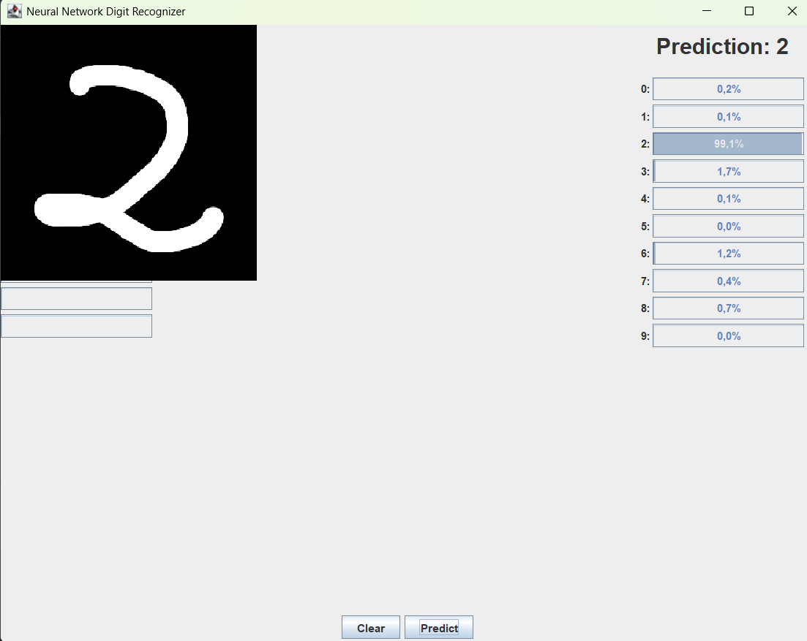

# 🧠 Java Neural Network From Scratch | MNIST Digit Recognizer

<p align="center">
  
  
  
  
</p>

<p align="center">
  A lightweight, fully functional <b>Multilayer Perceptron (MLP)</b> implemented completely from scratch in <b>pure Java</b> — without relying on external ML libraries like TensorFlow, PyTorch, or Deeplearning4j.
</p>

---

## 📌 Overview

This project was built to explore the internal mathematics of neural networks "under the hood", applying fundamental linear algebra and multivariable calculus. The design and mechanics were heavily inspired by [3Blue1Brown's Neural Network series](https://www.youtube.com/watch?v=aircAruvnKk).

The repository includes bundled MNIST data files and pre-trained network weights, allowing you to launch and test the interactive digit-drawing application right away.

---

## ✨ Features

- **No Third-Party ML Frameworks:** Core matrix operations, forward propagation, and backpropagation are written entirely by hand.
- **Custom Linear Algebra Engine (`Matrix.java`):** Dot products, matrix transpositions, scalar arithmetic, and element-wise operations (Hadamard product).
- **Fast Startup via Serialization:** Uses Java's built-in `ObjectOutputStream` / `ObjectInputStream` to save and restore network weights from disk (`first_saved_network.txt`), bypassing retraining on launch.
- **Interactive Swing GUI:** A standalone window featuring a drawing canvas, prediction readouts, and individual probability bars for each class ($0$–$9$).
- **Anti-Aliasing & Downscaling:** Automatically scales user drawings from the $280 \times 280$ canvas down to the network's native $28 \times 28$ resolution using area averaging to match standard MNIST strokes.

---

## 🏗 Architecture & Math

```
Input (784) ───► Hidden 1 (16) ───► Hidden 2 (16) ───► Output (10)
```

## 🚀 Getting Started
Java Development Kit (JDK 8 or higher).
Current version: Java 24.

## 📸 Preview

